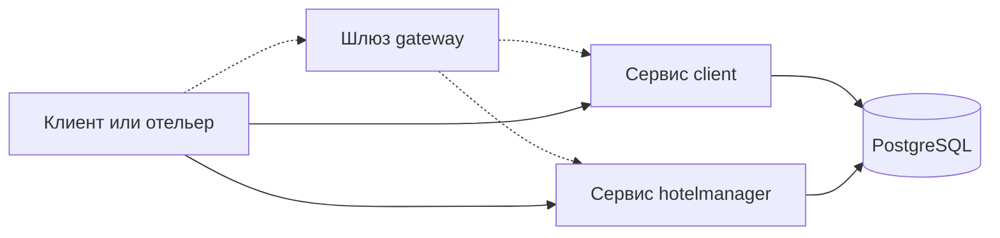

# Booking API и контроль доступа

Справочник описывает 14 бизнес-операций, сессионный вход и CSRF в модулях `client` и `hotelmanager`. Статусы в таблицах сверены с текущим кодом.

- [Адреса и маршрутизация](#routing)
- [Схема системы](#architecture)
- [API клиента и каталога](#client-api)
- [API отельера](#manager-api)
- [Поля запросов и ответов](#schemas)
- [Матрица доступа и локальные проверки](#verification)
- [Пример журнального события](#audit-example)

<a id="routing"></a>
## Адреса и маршрутизация

| Компонент | Адрес по конфигурации |
| --- | --- |
| `client` | `http://localhost:8070` |
| `hotelmanager` | `http://localhost:8090` |
| `gateway` | В конфигурации задан порт `8222`. Compose публикует `8080:8080`. |
| PostgreSQL | `postgres:5432` внутри сети Compose. Порт на хосте не опубликован. |

Шлюз по текущей схеме должен направлять каталог и бронирования в `client`, а `/api/manager/**` — в `hotelmanager`. Маршрутизация и вход через шлюз остаются непроверенными. [Конфигурация шлюза](../configserver/src/main/resources/configurations/gateway.yml) · [Docker Compose](../docker-compose.yml)

<a id="architecture"></a>
## Схема системы



Пунктиром показан предусмотренный путь через шлюз. Сплошными линиями показаны сценарии, которые проверялись через MockMvc и PostgreSQL отдельно в каждом модуле.

<a id="client-api"></a>
## API клиента и каталога

Идентификаторы в пути имеют тип `int`. Тела запросов передаются как `application/json`. Даты передаются строками ISO 8601 со смещением часового пояса. Примеры используют UTC.

| Метод и путь | Вход | Ответ контроллера и особенности |
| --- | --- | --- |
| `POST /api/booking/room` | Сессия клиента, CSRF-токен и `ReservationRequest` | `200` и строка `Room is reservation successfully!`. Владельца определяет аутентифицированная учётная запись. `400` для некорректного периода, `403` при отсутствии требуемой роли, профиля или действительного CSRF-токена, `404` для отсутствующего номера, `409` для недоступного номера. |
| `GET /api/client/{clientId}/reservations` | Сессия клиента, `clientId` в пути | `200` и массив `BookingForClientDto`. Если список владельца пуст, `404` без тела. Без входа возвращается `401`. При отсутствии роли или профиля клиента и при запросе чужого списка возвращается `403` до чтения броней. |
| `GET /api/search/hotels/available` | JSON `SearchHotelDto` | `200` и массив `HotelForClientDto`, отфильтрованный по городу и периоду. `400` для некорректного периода. |
| `GET /api/search/hotels/{hotelId}/information` | `hotelId` в пути, JSON `SearchRoomDto` | `200` и массив подходящих номеров `RoomForClientDto`. `400` для некорректного периода. |

[Контроллер создания брони](../client/src/main/java/com/lilsf/client/controller/BookingController.java) · [Контроллер списка броней](../client/src/main/java/com/lilsf/client/controller/ClientController.java) · [Контроллер поиска](../client/src/main/java/com/lilsf/client/controller/HotelSearchController.java)

Даты приводятся к календарным датам в часовом поясе сервиса. В поиске и при создании брони период включает день заезда и исключает день выезда. Заезд в день выезда предыдущего гостя допустим. У административной блокировки номера крайняя дата включена, поэтому блокировка с одинаковыми началом и концом закрывает один день.

### Сессионный вход в client

Для ручной проверки открой `GET /login` на порту `8070`. Войди под пользователем с ролью `CLIENT`, BCrypt-хешем пароля и профилем в `clients`. В той же сессии получи `GET /api/csrf` и передай токен в заголовке `X-CSRF-TOKEN` при создании брони. [Настройка Spring Security](../client/src/main/java/com/lilsf/client/security/ClientSecurityConfig.java) · [Маршрут CSRF](../client/src/main/java/com/lilsf/client/controller/CsrfController.java)

Оба поисковых GET сейчас принимают JSON-тело. Для запроса к API используй HTTP-клиент с поддержкой такого тела.

Пример тела для локальной проверки поиска с тестовым каталогом:

```json
{
  "city": "Казань",
  "startDate": "2027-01-10T00:00:00Z",
  "endDate": "2027-01-12T00:00:00Z"
}
```

<a id="manager-api"></a>
## API отельера

Все десять бизнес-операций требуют роль `HOTEL_MANAGER` и профиль отельера. Контроллер находит профиль по имени из аутентифицированной сессии. При чтении без входа API возвращает `401`. Вошедший пользователь без нужной роли или профиля получает `403`. Изменяющие запросы также получают `403` при отсутствующем или недействительном CSRF-токене. Отсутствующий или недоступный отель или номер возвращает `404` при чтении, изменении и удалении. Списки доступных объектов могут быть пустыми с `200`.

Для локальной проверки подключись напрямую к `hotelmanager` на порту `8090`. Войди через `/login` под пользователем с BCrypt-хешем пароля и связанной строкой в `hotel_managers`. Сервис использует cookie `BOOKING_MANAGER_SESSION`. Перед изменяющим запросом получи токен через `GET /api/manager/csrf` в той же сессии и передай его в заголовке `X-CSRF-TOKEN`. [Настройка Spring Security](../hotelmanager/src/main/java/com/lilsf/hotelmanager/security/HotelManagerSecurityConfig.java) · [OpenAPI отельера](../Swagger/Bookings_microservices-openapi_3.yaml)

| Метод и путь | Вход | Явно заданный ответ |
| --- | --- | --- |
| `GET /api/manager/hotels` | — | `200`, массив `HotelForManagerDto`. |
| `GET /api/manager/hotels/{id}` | `id` отеля | `200`, `HotelForManagerDto`. |
| `POST /api/manager/hotels/add` | `HotelDto` | `200`, `HotelForManagerDto`. |
| `PUT /api/manager/hotels/{id}` | `id` отеля и `HotelDto` | `200`, `HotelForManagerDto`. |
| `DELETE /api/manager/hotels/{id}` | `id` отеля | `200`, строка `Hotel is deleted successfully!`. |
| `GET /api/manager/hotels/{hotelId}/rooms` | `hotelId` | `200`, массив `RoomForManagerDto`. |
| `GET /api/manager/hotels/{hotelId}/rooms/{roomId}` | `hotelId` и `roomId` | `200`, `RoomForManagerDto`. |
| `POST /api/manager/hotels/{hotelId}/rooms/add` | `hotelId` и `RoomDto` | `200`, `RoomForManagerDto`. |
| `PUT /api/manager/hotels/{hotelId}/rooms/{id}` | `hotelId`, `id` номера и `RoomDto` | `200`, `RoomForManagerDto`. |
| `DELETE /api/manager/hotels/{hotelId}/rooms/{roomId}` | `hotelId` и `roomId` | `200`, строка `Room is deleted successfully!`. |

[Контроллер отельера](../hotelmanager/src/main/java/com/lilsf/hotelmanager/controller/HotelManagerController.java)

<a id="schemas"></a>
## Поля запросов и ответов

| Модель | Поля |
| --- | --- |
| `ReservationRequest` | Имя Java-класса `reservationHotelDto`. `roomId` — целое число. `startDate`, `endDate` — даты. |
| `SearchHotelDto` | `city` — строка. `startDate`, `endDate` — даты. |
| `SearchRoomDto` | `startDate`, `endDate` — даты. |
| `BookingForClientDto` | `id`, `startDate`, `endDate`, `discountPercent`, `bookingStatus`, `totalPrice`, `hotel`, `name`, `description`, `currentPrice`, `roomType`. Маппер не заполняет `bookingStatus`. Поля `hotel` и `name` содержат имя отеля и название номера соответственно. |
| `HotelForClientDto` | `id`, `name`, `description`, `categoryType`, `lineAddress`, `city`, `country`. |
| `RoomForClientDto` | `clientId`, `name`, `description`, `currentPrice`, `roomType`. В `clientId` маппер записывает идентификатор номера. |
| `HotelDto` и `HotelForManagerDto` | `name`, `description`, `active`, `categoryType`, `line`, `city`, `country`. Ответ отельера дополняется `id`. |
| `RoomDto` и `RoomForManagerDto` | `name`, `description`, `currentPrice`, `roomType`. Ответ дополнен `roomId`. |

`categoryType` допускает `HOTEL`. `roomType` допускает `SINGLE` и `DOUBLE`. В модели брони предусмотрены `CONFIRMED` и `CANCELLED`. Денежные поля и процент скидки имеют тип `BigDecimal` и передаются как JSON-числа при стандартной сериализации. В клиентских OpenAPI-файлах описание части статусов и числовых полей неполное. Для этих операций ориентируйся на таблицы выше. [DTO клиента](../client/src/main/java/com/lilsf/client/dto) · [Мапперы клиента](../client/src/main/java/com/lilsf/client/controller/mapper) · [DTO отельера](../hotelmanager/src/main/java/com/lilsf/hotelmanager/dto) · [Текущие OpenAPI-файлы](../Swagger)

<a id="verification"></a>
## Матрица доступа и локальные проверки

В проверочном прогоне прошли все 65 целевых тестов. В `client` прошли 25 тестов, включая 4 на реальной PostgreSQL. В `hotelmanager` прошли 40 тестов, включая 3 на реальной PostgreSQL. Интеграционные тесты выполняли запросы через MockMvc к каждому модулю отдельно. [Тесты клиента на PostgreSQL](../client/src/test/java/com/lilsf/client/integration/BookingPostgresTest.java) · [Тесты отельера на PostgreSQL](../hotelmanager/src/test/java/com/lilsf/hotelmanager/integration/HotelManagerPostgresTest.java)

Команды запускаются в PowerShell из указанного модуля с JDK 23. Для классов на PostgreSQL предварительно задай `BOOKING_TEST_DB_URL`, `BOOKING_TEST_DB_USER` и `BOOKING_TEST_DB_PASSWORD` для отдельной локальной тестовой базы. Тесты создают собственную схему. Без URL классы на PostgreSQL пропускаются.

| Роль или состояние | Действие | Объект | Проверка | Модуль и команда |
| --- | --- | --- | --- | --- |
| Без входа | Искать отели и номера | Публичный каталог | Оба GET-запроса возвращают `200`. [HotelSearchControllerTest](../client/src/test/java/com/lilsf/client/integration/HotelSearchControllerTest.java) | `client` · `.\mvnw.cmd "-Dtest=HotelSearchControllerTest" test` |
| Без входа | Читать список или создавать бронь | Бронирования | GET возвращает `401`. POST без CSRF возвращает `403`. В БД нет новой брони. [BookingPostgresTest](../client/src/test/java/com/lilsf/client/integration/BookingPostgresTest.java#L133) | `client` · `.\mvnw.cmd "-Dtest=BookingPostgresTest#rejectsInvalidDatesAndAnonymousRequestsWithoutWriting" test` |
| `CLIENT` | Создать бронь и прочитать список | Свои и чужие брони | Владельца создаваемой брони определяет сессия. Два клиента получают свои списки, чтение списка другого клиента возвращает `403`. [BookingPostgresTest](../client/src/test/java/com/lilsf/client/integration/BookingPostgresTest.java#L101) | `client` · `.\mvnw.cmd "-Dtest=BookingPostgresTest#createsBookingsWithCorrectPriceAndAllowsCheckoutDayAsNextCheckIn" test` |
| `CLIENT` без CSRF-токена | Создать бронь | Бронирование | POST возвращает `403`. Сервис бронирования не вызывается. [BookingControllerTest](../client/src/test/java/com/lilsf/client/integration/BookingControllerTest.java) | `client` · `.\mvnw.cmd "-Dtest=BookingControllerTest#reservationWithoutCsrfIsRejected" test` |
| Без входа или `CLIENT` | Читать список отелей отельера | `/api/manager/hotels` | Без входа возвращается `401`, с ролью `CLIENT` — `403`. [HotelManagerPostgresTest](../hotelmanager/src/test/java/com/lilsf/hotelmanager/integration/HotelManagerPostgresTest.java#L108) | `hotelmanager` · `.\mvnw.cmd "-Dtest=HotelManagerPostgresTest#anonymousAndClientUsersCannotUseManagerApi" test` |
| `HOTEL_MANAGER` | Создать, прочитать, изменить или удалить отель | Свой или чужой отель | Новый отель привязан к вошедшему отельеру. Удаление своего работает. Чтение, изменение и удаление чужого возвращают `404`, запись в БД сохраняется. [HotelManagerPostgresTest](../hotelmanager/src/test/java/com/lilsf/hotelmanager/integration/HotelManagerPostgresTest.java#L120) | `hotelmanager` · `.\mvnw.cmd "-Dtest=HotelManagerPostgresTest#managerOwnsNewHotelAndOtherHotelsReturn404" test` |
| `HOTEL_MANAGER` | Прочитать, изменить или удалить номер | Номер своего или другого отеля | Обновление своего номера проходит. Чтение, обновление и удаление чужого номера возвращают `404`, в том числе при указании своего `hotelId`. Запись другого отельера в БД сохраняется. [HotelManagerPostgresTest](../hotelmanager/src/test/java/com/lilsf/hotelmanager/integration/HotelManagerPostgresTest.java#L89) | `hotelmanager` · `.\mvnw.cmd "-Dtest=HotelManagerPostgresTest#managerMayUpdateOwnRoomButCannotReadOrChangeAnotherManagersRoom" test` |
| `HOTEL_MANAGER` без CSRF-токена | Обновить номер | Свой номер | PUT возвращает `403`, номер в БД остаётся прежним. [HotelManagerPostgresTest](../hotelmanager/src/test/java/com/lilsf/hotelmanager/integration/HotelManagerPostgresTest.java#L108) | `hotelmanager` · `.\mvnw.cmd "-Dtest=HotelManagerPostgresTest#anonymousAndClientUsersCannotUseManagerApi" test` |

Полный класс `BookingPostgresTest` также проверяет корректные даты и цену, ответы `400` и `409` и сохранение одной брони при двух конкурентных запросах. Для запуска всего класса из `client` используй `.\mvnw.cmd "-Dtest=BookingPostgresTest" test`. [Проверки бронирования](../client/src/test/java/com/lilsf/client/integration/BookingPostgresTest.java)

<a id="audit-example"></a>
## Пример журнального события

**Учебный JSON-пример события отказа.** В текущем приложении такой формат аудита отсутствует. Ответ `404` и отсутствие изменений в PostgreSQL подтверждены тестом. [Тест отказа при обновлении номера](../hotelmanager/src/test/java/com/lilsf/hotelmanager/integration/HotelManagerPostgresTest.java#L89)

```json
{
  "event": "access_denied",
  "requestId": "demo-request-001",
  "service": "hotelmanager",
  "actorRole": "HOTEL_MANAGER",
  "actorId": "manager-demo-01",
  "action": "room.update",
  "resourceType": "room",
  "resourceId": "room-demo-02",
  "result": "denied",
  "httpStatus": 404
}
```
